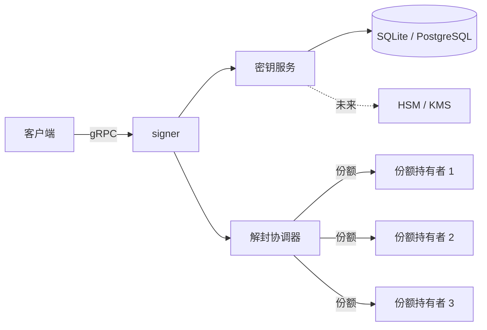

# signer

**基于 Rust 的 gRPC 签名服务，支持门限解封（quorum unsealing）。**

> ⚠️ 早期开发阶段，未经安全审计，请勿用于真实资产。

## 项目定位

`signer` 以密文形式保存私钥，启动时必须由预设数量的份额持有者共同提供 Shamir 份额，恢复出密钥加密密钥（KEK）后才能解密私钥并提供签名服务。目标是支持 secp256k1 + ECDSA（EVM）与 edwards25519 + EdDSA（Solana）。

## 它不是什么（v0.1）

v0.1 的目标是**门限密钥托管 / 门限解封**，不是门限签名。解封之后，完整私钥存在于 signer 进程内存中，任何一个已解封的实例都可以独立签名。真正的门限签名——Ed25519 用 FROST、ECDSA 用 CGGMP21——在路线图中。

## 状态

| 里程碑 | 范围 | 状态 |
| --- | --- | --- |
| v0.1 | 单签 + Shamir 门限解封 | 🚧 进行中（存储层已实现） |
| v0.2 | 份额轮换、mTLS、监控指标 | ☐ 计划中 |
| v0.3 | 门限签名（FROST / CGGMP21） | ☐ 计划中 |

## 当前进度

| 模块 | 状态 |
| --- | --- |
| 存储模型、迁移、SQLite / PostgreSQL 实现 | ✅ 已实现，含测试 |
| KEK 初始化与加密份额分发（signer-admin） | ✅ 已实现 |
| 门限解封（Shamir 会话、KEK 恢复与校验） | ✅ 核心已实现 |
| gRPC 解封接口（StartUnseal / SubmitUnsealShare / GetUnsealStatus / Seal） | ✅ 已实现 |
| 桌面端 Holder 身份、份额 vault 与解封提交（Tauri） | ✅ 已实现 |
| 加密 keystore（DEK/KEK、Shamir 分享） | 🚧 开发中 |
| 份额传输加密、持有者签名、VSS | 🚧 计划中 |
| 密钥管理接口与签名（ECDSA / EdDSA） | 🚧 未开始 |

## v0.1 目标特性

以下为 v0.1 目标；当前仅存储层完成实现，其余仍在开发中。

- 加密存储：每密钥独立 DEK，KEK 信封包裹（XChaCha20-Poly1305）
- 支持导入已有私钥（secp256k1 标量 / edwards25519 种子）
- 份额分发：对 Shamir 份额做 X25519 信封加密，每个持有者用本地私钥解密
- 门限解封：对密钥加密密钥做 Shamir 秘密分享，解封时用 KEK 校验密文验证重建结果（VSS 待补）
- 签名：secp256k1 + ECDSA（EVM）与 edwards25519 + EdDSA（Solana）
- gRPC 解封接口（tonic）：StartUnseal / SubmitUnsealShare / GetUnsealStatus / Seal
- 所有密钥操作写入审计日志
- 存储层抽象：SQLite（单机）/ PostgreSQL（集群）共用同一套 trait

## 架构



更多细节：[docs/architecture.md](docs/architecture.md)

## 快速开始

前置：Rust 1.85+、Docker（运行测试时）。protoc 已由 `protoc-bin-vendored` 随构建提供。

先完成一次初始化仪式：

```bash
# 1. 每个份额持有者生成自己的 X25519 密钥（在各自机器上执行）
cargo run -p signer-admin -- holder-keygen --out holder-1.key

# 2. 收集公钥到 holders.json
#    [{"id":"holder-1","public_key":"<hex>"}, ...]

# 3. 生成 operator 签名密钥（可选；桌面端验证 manifest 时需要）
cargo run -p signer-admin -- operator-keygen --out operator.key --pub-out operator.pub

# 4. 生成 KEK、Shamir 分片并加密导出 share 文件
cargo run -p signer-admin -- init --holders holders.json --operator-key operator.key

# 5. 启动服务
cargo run -p signer-server
```

`holders.json` 既接受旧格式 `{"id": "...", "public_key": "<x25519 hex>"}`，也接受桌面端导出的 holder public bundle（`holder_id`、`x25519_public`、`ed25519_public`、`self_signature`）。提供 `--operator-key` 时，`init` 还会写出 `manifest.json`、`manifest.sig` 和 `operator.pub`，桌面端可据此验证份额来源。

服务端不再自动生成 KEK；缺少 `data/kek_check.json` 会报错并提示先执行 `signer-admin init`。生成的 `data/shares/*.share` 必须交给对应持有者，`data/` 不能提交到仓库。

可用环境变量：`SIGNER_GRPC_ADDR`、`SIGNER_DATA_DIR`、`SIGNER_SESSION_TTL_SECS`。

### 桌面客户端

`desktop/` 下是 Tauri 可视化客户端，覆盖操作员和份额持有者的流程：

```bash
cd desktop/src-tauri
cargo run
```

默认连接 `http://127.0.0.1:50051`。界面顶部可在「操作员」和「份额持有者」之间切换；持有者 tab 内再分「密钥分发」和「Unseal」：前者生成身份、导出公开信息、导入并验证 `.share`、把份额加密保存为本地 vault，后者用 Session ID 从 vault 解锁提交。manifest 三项（`manifest.json`、`manifest.sig`、`operator.pub`）可选；不提供时按 legacy 方式导入并显示未验签警告。v0.1 的 gRPC 份额传输未加密，仅限本机或可信网络演示。

## 仓库结构

| 路径 | 说明 |
| --- | --- |
| `crates/proto` | `signer.v1` proto 与生成的 Rust 代码 |
| `crates/core` | 存储层与门限解封核心 |
| `crates/holder` | Holder 身份、manifest 验签、share vault 与份额导入 |
| `crates/share` | X25519 份额信封加密 |
| `crates/admin` | KEK 初始化与份额分发工具 |
| `crates/server` | gRPC 服务与二进制入口 |
| `desktop` | Tauri 桌面解封客户端 |
| `migrations` | PostgreSQL / SQLite 迁移 |
| `proto` | protobuf 源文件 |
| `docs` | 设计与运维文档 |

## API

gRPC 定义见 [`proto/signer/v1/signer.proto`](proto/signer/v1/signer.proto)。解封相关方法已实现；`CreateKey`、`ImportKey`、`GetPublicKey`、`ListKeys`、`Sign` 目前返回 `UNIMPLEMENTED`。

| 方法 | 说明 |
| --- | --- |
| `CreateKey` / `ImportKey` | 生成新密钥 / 导入已有私钥 |
| `GetPublicKey` / `ListKeys` | 查询公钥与密钥元数据 |
| `Sign` | 使用指定密钥签名（需已解封） |
| `StartUnseal` / `SubmitUnsealShare` / `GetUnsealStatus` | 门限解封 |
| `Seal` | 重新封存，擦除内存中的密钥材料 |

健康检查使用标准 `grpc.health.v1.Health`，错误码约定见 proto 文件顶部注释。

## 安全

- 威胁模型：[docs/threat-model.md](docs/threat-model.md)
- 密钥生命周期：[docs/key-lifecycle.md](docs/key-lifecycle.md)
- 解封协议：[docs/unseal-protocol.md](docs/unseal-protocol.md)
- 漏洞报告：[SECURITY.md](SECURITY.md)

## 文档

| 文档 | 用途 |
| --- | --- |
| [docs/architecture.md](docs/architecture.md) | 组件、数据流、部署拓扑 |
| [docs/threat-model.md](docs/threat-model.md) | 资产、信任边界、非目标 |
| [docs/key-lifecycle.md](docs/key-lifecycle.md) | 密钥创建、轮换、备份、销毁 |
| [docs/unseal-protocol.md](docs/unseal-protocol.md) | 门限解封协议 |
| [docs/storage.md](docs/storage.md) | 存储 trait、表结构、HA |
| [docs/operations.md](docs/operations.md) | 配置、可观测性、运维手册 |
| [desktop/README.md](desktop/README.md) | Tauri 桌面客户端 |
| [docs/adr/](docs/adr/) | 架构决策记录 |
| [ROADMAP.md](ROADMAP.md) | 里程碑计划 |
| [CHANGELOG.md](CHANGELOG.md) | 版本变更记录 |

## 许可证

[Apache-2.0](LICENSE)

## 免责声明

本项目为学习与作品集用途的实现，未经安全审计，不得用于保护真实资产。
