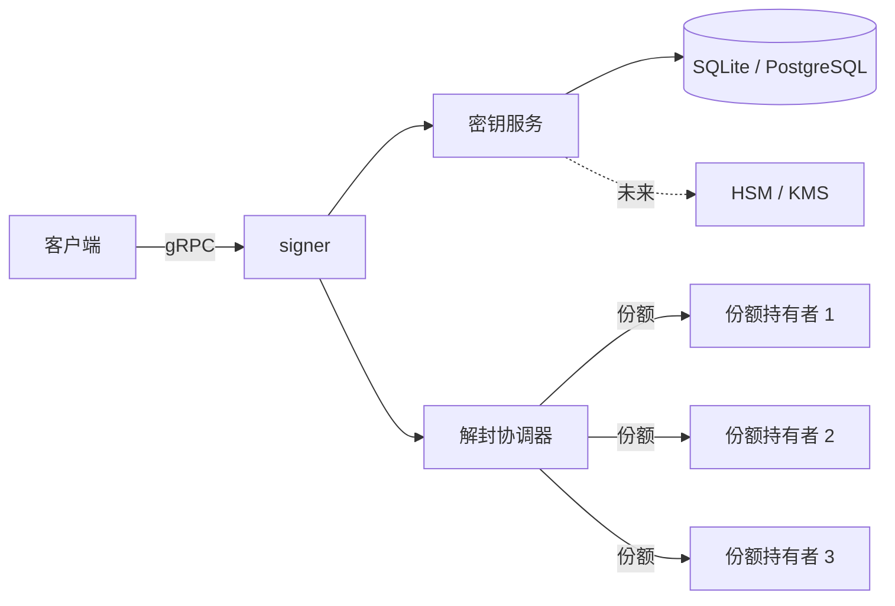

# signer

**基于 Rust 的 gRPC 签名服务，支持门限解封（quorum unsealing）。**

> ⚠️ 早期开发阶段，未经安全审计，请勿用于真实资产。

## 项目定位

`signer` 以密文形式保存私钥，启动时必须由预设数量的份额持有者共同提供 Shamir 份额，恢复出密钥加密密钥（KEK）后才能解密私钥并提供签名服务。目标是支持 secp256k1 + ECDSA（EVM）与 edwards25519 + EdDSA（Solana）。

## 它不是什么（v0.1）

v0.1 的目标是**门限密钥托管 / 门限解封**，不是门限签名。解封之后，完整私钥存在于 signer 进程内存中，任何一个已解封的实例都可以独立签名。真正的门限签名——Ed25519 用 FROST、ECDSA 用 CGGMP21——在路线图中。

## 状态

| 里程碑 | 范围 | 状态 |
| --- | --- | --- |
| v0.1 | 单签 + Shamir 门限解封 | 🚧 进行中（存储层已实现） |
| v0.2 | 份额轮换、mTLS、监控指标 | ☐ 计划中 |
| v0.3 | 门限签名（FROST / CGGMP21） | ☐ 计划中 |

## 当前进度

| 模块 | 状态 |
| --- | --- |
| 存储模型、迁移、SQLite / PostgreSQL 实现 | ✅ 已实现，含测试 |
| gRPC 接口定义 | ✅ proto 已定义，服务端未实现 |
| 加密 keystore（DEK/KEK、Shamir 分享） | 🚧 开发中 |
| 门限解封协议 | 🚧 设计完成，未实现 |
| 签名（ECDSA / EdDSA） | 🚧 未开始 |

## v0.1 目标特性

以下为 v0.1 目标；当前仅存储层完成实现，其余仍在开发中。

- 加密存储：每密钥独立 DEK，KEK 信封包裹（XChaCha20-Poly1305）
- 支持导入已有私钥（secp256k1 标量 / edwards25519 种子）
- 门限解封：对密钥加密密钥做 Shamir 秘密分享，支持可验证份额
- 签名：secp256k1 + ECDSA（EVM）与 edwards25519 + EdDSA（Solana）
- gRPC 接口（tonic），含健康检查与反射
- 所有密钥操作写入审计日志
- 存储层抽象：SQLite（单机）/ PostgreSQL（集群）共用同一套 trait

## 架构



更多细节：[docs/architecture.md](docs/architecture.md)

## 快速开始

当前只实现了存储层，服务端尚未接入。

```bash
cargo test   # 存储测试；PostgreSQL 用例需要本机 Docker
```

## API

gRPC 定义见 [`proto/signer/v1/signer.proto`](proto/signer/v1/signer.proto)。以下接口已定义，服务端尚未实现。

| 方法 | 说明 |
| --- | --- |
| `CreateKey` / `ImportKey` | 生成新密钥 / 导入已有私钥 |
| `GetPublicKey` / `ListKeys` | 查询公钥与密钥元数据 |
| `Sign` | 使用指定密钥签名（需已解封） |
| `StartUnseal` / `SubmitUnsealShare` / `GetUnsealStatus` | 门限解封 |
| `Seal` | 重新封存，擦除内存中的密钥材料 |

健康检查使用标准 `grpc.health.v1.Health`，错误码约定见 proto 文件顶部注释。

## 安全

- 威胁模型：[docs/threat-model.md](docs/threat-model.md)
- 密钥生命周期：[docs/key-lifecycle.md](docs/key-lifecycle.md)
- 解封协议：[docs/unseal-protocol.md](docs/unseal-protocol.md)
- 漏洞报告：[SECURITY.md](SECURITY.md)

## 文档

| 文档 | 用途 |
| --- | --- |
| [docs/architecture.md](docs/architecture.md) | 组件、数据流、部署拓扑 |
| [docs/threat-model.md](docs/threat-model.md) | 资产、信任边界、非目标 |
| [docs/key-lifecycle.md](docs/key-lifecycle.md) | 密钥创建、轮换、备份、销毁 |
| [docs/unseal-protocol.md](docs/unseal-protocol.md) | 门限解封协议 |
| [docs/storage.md](docs/storage.md) | 存储 trait、表结构、HA |
| [docs/operations.md](docs/operations.md) | 配置、可观测性、运维手册 |
| [docs/adr/](docs/adr/) | 架构决策记录 |
| [ROADMAP.md](ROADMAP.md) | 里程碑计划 |
| [CHANGELOG.md](CHANGELOG.md) | 版本变更记录 |

## 许可证

[Apache-2.0](LICENSE)

## 免责声明

本项目为学习与作品集用途的实现，未经安全审计，不得用于保护真实资产。
