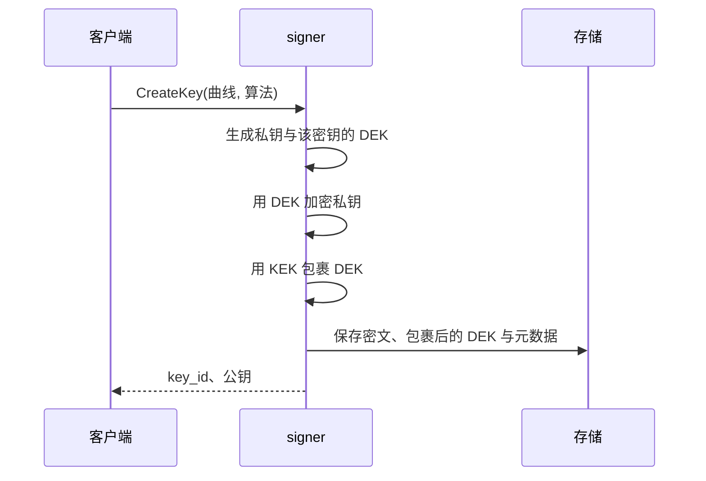
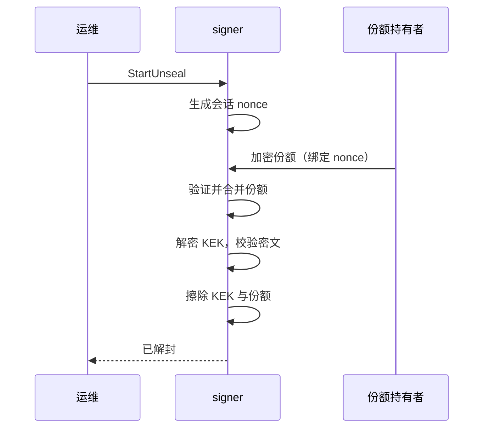
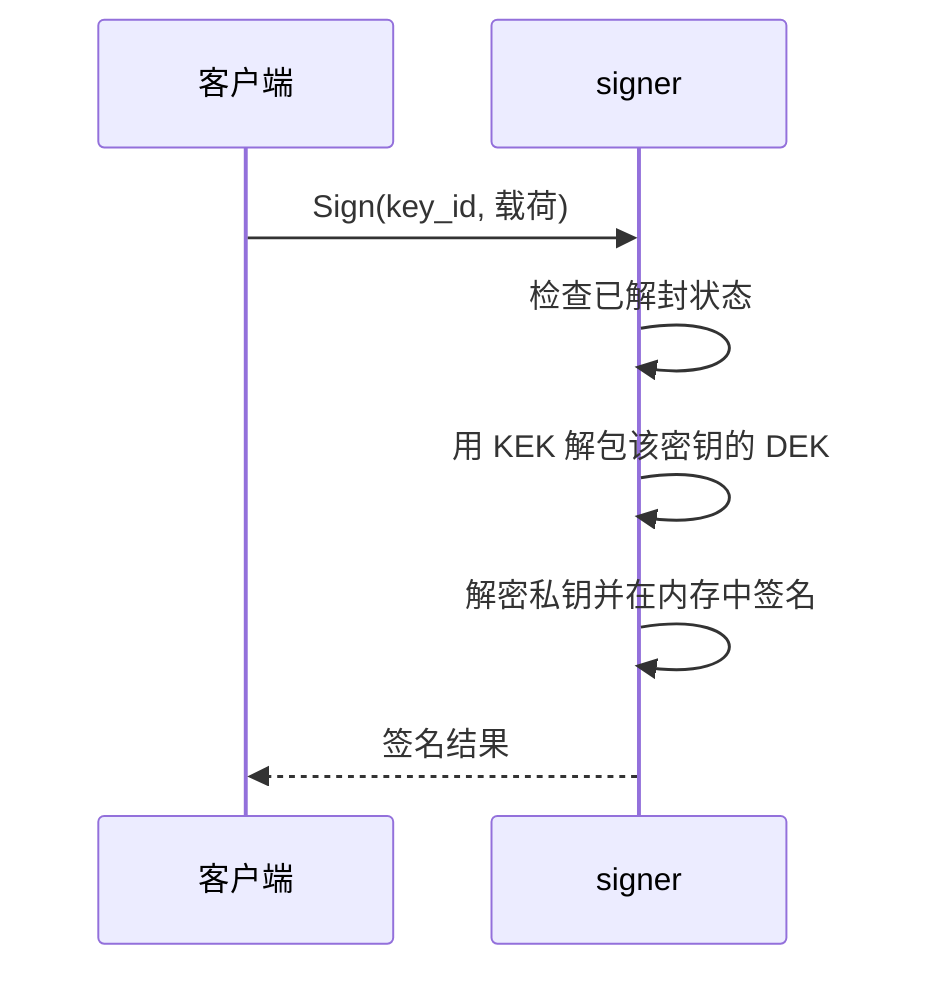

# 架构

> 状态：草稿——反映 v0.1 设计。存储、解封、Ed25519 keystore 和 CreateKey/Sign 审计已实现；secp256k1、ImportKey、其余操作审计与 mTLS 仍在开发中。

## 目标

- 私钥始终以密文形式落盘。
- 启动时必须由份额持有者达到阈值才能释放密钥加密密钥（KEK）。
- 为 EVM 与 Solana 密钥提供小而可审计的签名接口。
- 开发环境是单二进制，集群环境可做高可用部署。

## 非目标

- v0.1 不做门限签名（见 [ADR-0002](adr/0002-unseal-vs-threshold.md)）。
- 托管真实资产；项目未经审计。
- 超出 API 作用域的多租户鉴权。

## 组件

| 组件 | 职责 |
| --- | --- |
| `api` | gRPC 服务（tonic）、鉴权、请求校验 |
| `keystore` | 密钥生成、DEK/KEK 信封加密、签名 |
| `unseal` | 解封会话协调与份额验证 |
| `storage` | `KeyStore` trait 背后的持久化（SQLite / PostgreSQL） |
| `audit` | 只追加的密钥操作记录 |
| `signer-admin` | 离线初始化：生成 KEK、分片并导出加密份额 |
| `share` | X25519 信封加密，供份额分发与客户端解密 |
| 份额持有者 | 持有 KEK 的 Shamir 份额的外部参与方 |

### signer

服务仅在启动阶段有状态：必须先完成解封才能接受签名请求。解封之后，私钥材料只存在于进程内存，绝不落盘。

### 份额持有者

份额持有者是独立的进程或人员。协议不假设它们始终在线；解封是一次显式的仪式流程，不发生在请求路径上。

## 数据流

### 密钥创建

### 启动解封

### 签名

## 部署拓扑

### 单机

- 一个 signer 进程，SQLite 后端。
- 用于开发与演示。

### 高可用

- N 个 signer 实例挂在负载均衡后，共用一个 PostgreSQL 集群。
- 所有实例都必须完成解封；密钥生命周期操作通过行锁串行化。
- 参见 [storage.md](storage.md) 与 [operations.md](operations.md)。

## 设计原则

- 秘密绝不进入日志、链路追踪或错误信息。
- 失败即封闭：解封过程中有任何疑问，服务就保持 sealed。
- 信任边界尽量小：存储层只能看到密文。
- 显式记录威胁模型，而不是隐含假设。

## 相关文档

- [密码学设计](cryptography.md)：各密码学原语的原理、参数与使用位置

## 待决问题

- [ ] 解包后的 DEK / 私钥是否缓存，缓存多久？
- [ ] 份额持有者是否从第一天就启用 mTLS？
- [ ] 审计日志放在同一数据库，还是外部只追加存储？
- [ ] 份额轮换期间是否需要只读模式？
