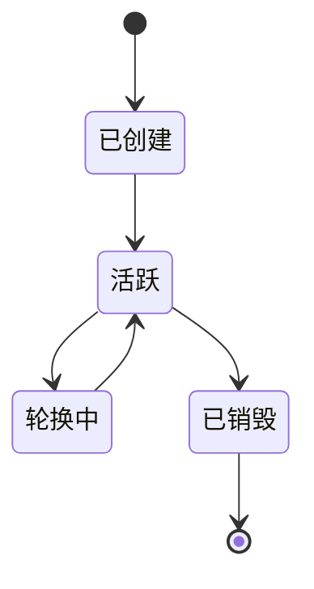

# 密钥生命周期

> 状态：草稿。

## 密钥状态

| 状态 | 含义 |
| --- | --- |
| `已创建` | 密钥已存在，但尚未批准用于签名 |
| `活跃` | 可用于签名 |
| `轮换中` | 旧密钥仍可验证，新密钥正在引入 |
| `已销毁` | 密文与元数据已删除；公钥可保留用于验签 |

## 创建

1. 使用操作系统 CSPRNG 在内存中生成私钥。
2. 使用 CSPRNG 为该密钥生成独立的 32 字节 DEK。
3. 用 DEK 以 XChaCha20-Poly1305 加密私钥。
4. 用 KEK 以 XChaCha20-Poly1305 包裹 DEK。
5. 持久化私钥密文、DEK 密文、两个 AEAD nonce、曲线、算法与公钥。
6. 擦除私钥明文、DEK 明文等缓冲区。
7. 写入审计事件。

TODO：如果份额按密钥单独生成，补充份额生成仪式流程。

## 导入

1. 校验曲线与算法组合（secp256k1+ECDSA / edwards25519+EdDSA）及私钥长度：secp256k1 为 32 字节标量，edwards25519 为 32 字节种子。
2. 派生公钥；若请求提供 `expected_public_key`，必须与其一致，否则拒绝导入。
3. 检查 `(curve, algorithm, public_key)` 是否已存在，重复导入返回 `ALREADY_EXISTS`。
4. 为该密钥生成独立 DEK，用 DEK 加密私钥，再用 KEK 包裹 DEK。
5. 持久化私钥密文、DEK 密文、两个 AEAD nonce、曲线、算法与公钥。
6. 立即擦除请求中的私钥明文与 DEK 明文。
7. 写入审计事件，不记录私钥内容。

导入的私钥必须通过 mTLS 传输，且调用方在发送后应清除本地明文。

## 解封

参见 [unseal-protocol.md](unseal-protocol.md)。解封只重建 KEK，KEK 在 unsealed 期间驻留内存，不持久化任何内容；各密钥的 DEK 在首次使用时解包，缓存策略见待决问题。

## 签名

- 要求密钥处于 `活跃` 状态，且服务已解封。
- 首次使用某密钥时，用 KEK 解包其 DEK，再用 DEK 解密私钥；解包与解密后的材料只存在于内存。
- 签名过程不得把明文密钥写到任何地方。
- 每次签名请求都写审计（密钥 ID、调用方、结果——不记录载荷）。

## 轮换

- 引入新密钥并标记为 `活跃`。
- 旧密钥保留用于验签，直到消费方完成迁移。
- 轮换 KEK：用新 KEK 重新包裹所有 DEK，私钥密文不变。
- 轮换单个密钥：生成新私钥与新 DEK（新 key_id），旧密钥进入验签保留期。
- 份额持有者集合变化时，必须轮换份额。

## 备份

- 只备份密文与元数据；KEK 和份额绝不能与数据库一起备份。
- 定期演练恢复流程。

## 销毁

- 删除密文与私有元数据。
- 在审计日志中记录销毁事件。
- 确认备份按保留策略到期。

## 审计事件

| 事件 | 字段 |
| --- | --- |
| `key.created` | key_id、曲线、算法、操作者 |
| `key.imported` | key_id、曲线、算法、操作者 |
| `key.unseal_started` | session_id、阈值、操作者 |
| `key.unsealed` | session_id、密钥数量、操作者 |
| `sign.requested` | key_id、操作者、结果 |
| `key.rotated` | 旧 key_id、新 key_id、操作者 |
| `key.destroyed` | key_id、操作者 |

## 待决问题

- [ ] 解包后的 DEK 与私钥是否缓存？缓存多久、何时擦除？
- [ ] 谁有权批准销毁密钥？
- [ ] 审计事件保留多久？
