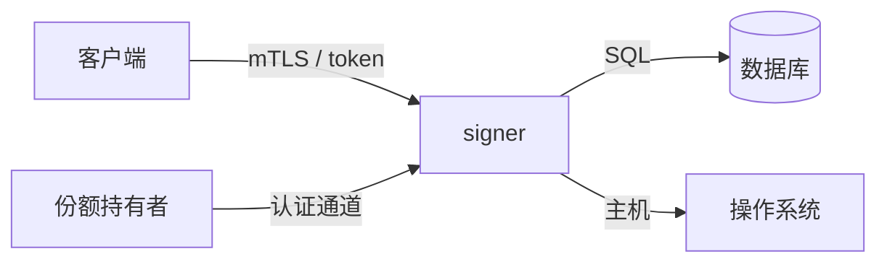

# 威胁模型

> 状态：草稿。每次涉及安全的改动都要评审本文件。

## 资产

| 资产 | 说明 |
| --- | --- |
| 私钥 | 用于签名的 secp256k1+ECDSA / edwards25519+EdDSA 密钥 |
| 密钥加密密钥（KEK） | 包裹各密钥 DEK 的对称密钥 |
| DEK | 每个密钥独立的数据加密密钥，直接加密私钥 |
| Shamir 份额 | 份额持有者保存的 KEK 份额 |
| 签名能力 | 能产生合法签名的能力 |
| 审计日志 | 密钥操作的记录 |

## 参与者

- 客户端——调用签名接口。
- 运维——运行 signer 并发起解封。
- 份额持有者——持有 KEK 的一个份额。
- 攻击者——外部人员或内部人员，试图获取密钥或未授权签名。

## 信任边界

- 客户端 → signer：需要认证，并按密钥授权。
- signer → 数据库：数据库只能看到密文。
- 份额持有者 → signer：持有者用 Ed25519 签名认证提交，份额加密到会话临时公钥；mTLS + 客户端证书权限位已实现，未配置 `[tls]` 时仍为明文、服务端身份未认证。
- signer → 操作系统：v0.1 视为可信；内存泄露不在范围内。

## 假设

- 解封状态下主机未被攻破。
- 达到阈值的份额持有者是诚实的；少于阈值的合谋无法恢复 KEK。
- 密码学原语（XChaCha20-Poly1305、secp256k1、Ed25519）与随机数生成由经过审计的库正确实现。
- mTLS + 客户端证书权限位已实现；未配置 `[tls]` 时仍按“无 TLS”假设，signer 只部署在本机或可信网络。启用后客户端 → signer 必须使用 mTLS，CA 负责在证书里签发权限位。

## 威胁与缓解

| 编号 | 威胁 | 影响 | 缓解措施 | 状态 |
| --- | --- | --- | --- | --- |
| T1 | 数据库或备份被盗 | 密钥泄露 | 私钥与包裹后的 DEK 只存密文；KEK 永不落盘 | ☐ |
| T2 | 单个内部人员尝试解封 | 未授权访问 | 必须达到阈值；每次会话都审计 | ☐ |
| T3 | 重放或注入份额 | 错误 KEK / 拒绝服务 | 会话 nonce 绑定、Ed25519 验签、每会话 X25519 加密、VSS 校验；传输层认证见 T12（已实现，需启用） | ◐ |
| T4 | 未授权签名请求 | 伪造签名 | 客户端证书内方法级权限位（`key.sign` 等）+ 按密钥鉴权、限流（设计中） | ◐ |
| T5 | 解封状态下内存被 dump | 密钥泄露 | KEK/DEK/私钥缓冲区 zeroize、缩短暴露时间；列为残余风险 | ☐ |
| T6 | 审计日志被篡改 | 失去可追责性 | 只追加表；外部存储（待定） | ☐ |
| T7 | 随机数质量不足 | 密钥可预测 | 使用操作系统 CSPRNG 与审计过的密码学库 | ☐ |
| T8 | 供应链投毒 | 密钥泄露 | 锁定依赖版本、`cargo audit`、审查密码学 crate | ☐ |
| T9 | 时钟偏移 / 会话过期 | 重放窗口 | 短会话有效期、单调过期时间 | ☐ |
| T10 | 私钥导入通道泄露 | 私钥暴露 | 强制 mTLS + `key.import` 权限位、禁止记录请求体、收到后立即加密并 zeroize、限制导入权限（mTLS 已实现，ImportKey 未实现） | ◐ |
| T11 | 分发的份额文件被截获 | 份额泄露 | 每个份额用持有者 X25519 公钥加密；manifest 由 operator 签名并绑定信封哈希；持有者本地 vault 用 Argon2id + XChaCha20-Poly1305 加密 | ◐ |
| T12 | 中间人替换会话公钥 | 骗取持有者份额 | 会话公钥与 nonce 由服务端生成，提交绑定上下文并验签；mTLS + 证书权限位已实现，未启用 TLS 时仍可 MITM | ◐ |
| T13 | CA 过度签发权限位 / 保留位被置 1 | 客户端获得不该有的 RPC 权限 | CA 模板和审批强制权限位；`tls-sign-csr` 丢弃 CSR 请求字段；保留位为 1 拒绝整张证书；短有效期；审计 principal | ◐ |
| T14 | CA 私钥泄露或口令被猜出 | 攻击者可签发任意权限证书 | CA key 使用 PKCS#8 PBES2 口令加密；只能存放在离线 CA 主机/HSM；`tls-sign-csr` 拒绝明文 CA key；签发审批和短有效期证书 | ◐ |

> ◐ 表示部分实现；☐ 表示未实现。

## 明确的非目标

- 不防护“解封状态下完全控制主机”的攻击者。
- 不防护达到阈值的份额持有者集体作恶。
- 不隐藏密钥数量、签名频率或时序元数据。
- 不防护拥有主机权限的攻击者发起的拒绝服务。

## 残余风险

- 解封之后，KEK 驻留进程内存，单个进程可以解包并持有完整私钥。这是“密钥解封”相对门限签名的根本局限，见 [ADR-0002](adr/0002-unseal-vs-threshold.md)。
- SQLite 部署没有内建高可用，依赖文件系统可靠性。
- 导入私钥的熵与保管历史无法由 signer 验证；导入后的安全性只取决于后续保护。
- mTLS 的授权根是 CA：CA 过度签发或私钥泄露，等价于客户端权限被攻破。signer 只能校验证书中的权限位，无法判断 CA 是否按制度签发。CSR 流程要求 CA 用自己的审批值重新签发，不能原样签署 CSR 请求的 SAN/权限。
- CA key 口令只保护静态文件；控制离线 CA 主机或 `tls-sign-csr` 运行环境的攻击者仍可签发证书。
- 本版不实现 CRL/OCSP，也没有本地 deny list；证书被窃后在有效期内仍可使用，撤销依赖短有效期证书和 CA 流程。
- 客户端证书权限位只覆盖 RPC 方法级权限；v1 不实现 key 级 label/tenant 范围。
- 服务端证书或 client CA bundle 轮换需要重启 signer，并重新走门限解封。

## 评审清单

- [ ] 改动是否引入了新的资产或信任边界？
- [ ] 秘密是否可能进入日志、指标标签、链路追踪或错误信息？
- [ ] 新输入在进入密码学运算前是否已校验？
- [ ] 是否为新的失败模式补充了异常测试？
