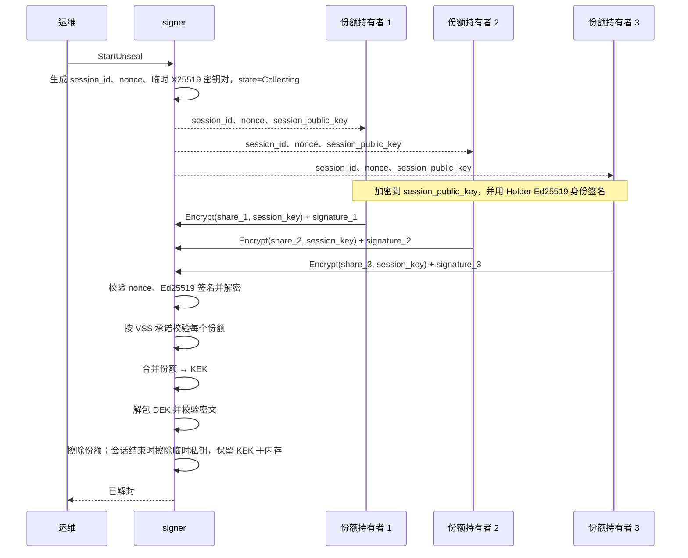

# 解封协议

> 状态：核心、gRPC 与桌面端已实现 Ristretto255 Feldman VSS、会话 nonce 绑定、持有者 Ed25519 签名，以及每会话 X25519 份额加密。服务端验签、解密、校验 VSS 后才计数；gRPC 仍无 TLS/鉴权，只适合本机或可信网络。
>
> VSS 实现说明见 [vss-unseal.md](vss-unseal.md)，决策见 [ADR-0007](adr/0007-vss-feldman-ristretto255.md)。

## 概述

密钥加密密钥（KEK）通过 Shamir 秘密分享拆成 `n` 份，阈值为 `t`。signer 启动时处于 sealed 状态，只有至少 `t` 个份额持有者为当前会话提供份额后，才会接受签名请求。

## 角色

- **运维**——发起解封会话并跟踪状态。
- **份额持有者**——持有份额，并通过认证通道提交。
- **signer**——协调会话、验证并合并份额。

## 参数

| 参数 | 含义 | 建议默认值 |
| --- | --- | --- |
| `n` | 份额总数 | 5 |
| `t` | 阈值 | 3 |
| `session_ttl` | 解封会话有效期 | 10 分钟 |

## 前置条件

- 服务处于 `Sealed` 状态。
- 份额持有者身份已配置并完成认证。
- 存储后端可达；使用 KEK 解密后密文能通过完整性校验。

## 流程

## 步骤

1. `StartUnseal`（或 `GetUnsealStatus`）创建/返回会话，包含随机的 `session_id`、32 字节 `nonce` 和本次会话专用的临时 X25519 公钥 `session_public_key`；临时私钥只存在于内存。
2. 持有者从状态接口取得 `nonce` 与 `session_public_key`，构造提交上下文：
   `domain || len(session_id) || session_id || nonce || session_public_key || len(holder_id) || holder_id || share_index`。
3. 持有者用 `session_public_key` 通过 v2 信封加密份额，AEAD 的 AAD 绑定上述上下文；再用 Holder 身份 Ed25519 私钥对
   `domain || SHA-256(context) || SHA-256(ciphertext)` 签名，提交密文、签名、索引和 `nonce`。
4. signer 在接受份额前校验发送方注册身份、索引、`nonce`、Ed25519 签名，并用会话临时私钥解密；解密失败、索引不符或长度不为 33 字节都拒绝。
5. 解密后的份额要与拆分时生成的 VSS 承诺比对。
6. 收集到 `t` 个有效份额后，signer 在可擦除缓冲区中重建 KEK。
7. signer 用恢复出的 KEK 解包一条 DEK，再用该 DEK 解密对应的私钥密文；两层 AEAD 认证都成功才确认 KEK 正确。
8. 擦除全部份额；KEK 保留在内存中，用于后续按需解包各密钥的 DEK。
9. 会话标记为 `Unsealed`，并写入审计日志。

解封只负责重建 KEK。Ed25519/secp256k1 keystore 在每次签名时用 KEK 解包 DEK、用 DEK 解密私钥，签名后立即 zeroize；当前不做 DEK 缓存。

## 失败处理

| 失败情况 | 行为 |
| --- | --- |
| `nonce` 不匹配或缺失 | 拒绝该份额，不计数 |
| Ed25519 签名无效或持有者未注册 | 拒绝该份额，不计数 |
| 密文无法用会话私钥解密 | 拒绝该份额，不计数 |
| 份额索引不符或长度不为 33 字节 | 拒绝该份额，不计数 |
| 份额未通过 VSS 校验 | 拒绝该份额，继续收集，并审计本次尝试 |
| 同一持有者重复提交 | 拒绝，`ALREADY_EXISTS` |
| 会话超时 | 标记为 `Expired`，必须重新发起会话 |
| AEAD 认证失败 | 保持 sealed，视为严重错误 |
| 收集过程中 signer 重启 | 丢弃会话；会话不做持久化 |

## 安全考量

- 份额绝不能进入日志或错误信息。
- 提交上下文绑定 `session_id`、`nonce`、`session_public_key`、holder id 和 index；AEAD AAD 与 Ed25519 签名都覆盖该上下文，密文不能跨会话或跨持有者重放。
- 每个会话生成独立的临时 X25519 密钥对；会话结束后私钥随会话一起擦除，历史密文不能在后续会话中解密。
- 持有者 Ed25519 签名认证提交方，服务端在计数前完成验签、解密和 VSS 校验。
- 当前 gRPC 没有 TLS/服务端认证：中间人仍可替换 `session_public_key` 与 `nonce` 骗取份额（无法伪造最终 KEK 校验），因此只能部署在本机或可信网络，接入 mTLS 前不得跨不可信网络使用。
- 解封不持久化 KEK；KEK 只在 unsealed 期间驻留内存，进程退出或重新 sealed 时立即擦除。磁盘上不存在可被攻击者翻转的 sealed/unsealed 标志。

## 待决问题

- [ ] 解包后的 DEK / 私钥是否缓存，何时擦除？
- [ ] 份额持有者身份如何轮换，轮换时如何重新分发份额？
- [ ] 是否为 gRPC 接入 mTLS 与服务端公钥固定？
- [ ] 后续版本是否支持通过 KMS 自动解封？
