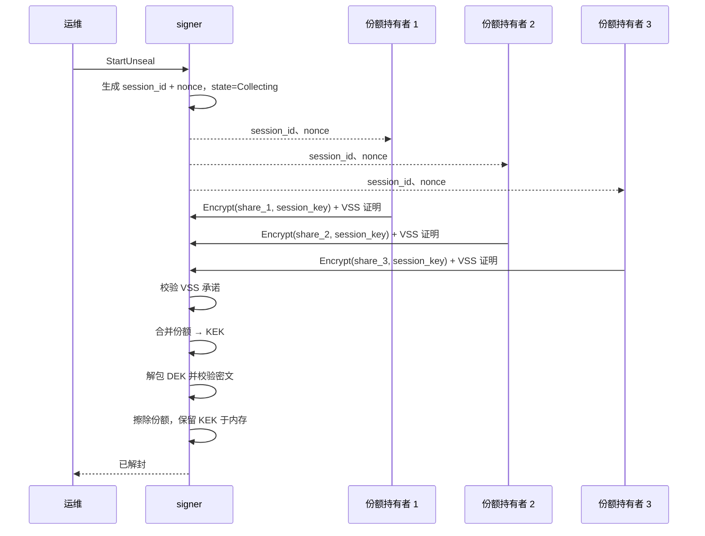

# 解封协议

> 状态：核心与 gRPC 接口已实现（Shamir 分片、会话收集、KEK 校验、重新封存）；份额离线分发已使用 X25519 信封加密；gRPC 传输仍为解密后的原始份额，持有者签名与 VSS 校验待接入。

## 概述

密钥加密密钥（KEK）通过 Shamir 秘密分享拆成 `n` 份，阈值为 `t`。signer 启动时处于 sealed 状态，只有至少 `t` 个份额持有者为当前会话提供份额后，才会接受签名请求。

## 角色

- **运维**——发起解封会话并跟踪状态。
- **份额持有者**——持有份额，并通过认证通道提交。
- **signer**——协调会话、验证并合并份额。

## 参数

| 参数 | 含义 | 建议默认值 |
| --- | --- | --- |
| `n` | 份额总数 | 5 |
| `t` | 阈值 | 3 |
| `session_ttl` | 解封会话有效期 | 10 分钟 |

## 前置条件

- 服务处于 `Sealed` 状态。
- 份额持有者身份已配置并完成认证。
- 存储后端可达；使用 KEK 解密后密文能通过完整性校验。

## 流程

## 步骤

1. `StartUnseal` 创建会话，生成随机的 `session_id` 与 `nonce`，记录阈值和符合条件的份额持有者。
2. 每个份额持有者把份额加密到 signer 的会话公钥，并对“密文 + `session_id` + `nonce`”签名。
3. signer 在接受份额前校验发送方身份、签名和会话绑定。
4. 已接受的份额要与拆分时生成的 VSS 承诺比对。
5. 收集到 `t` 个有效份额后，signer 在可擦除缓冲区中重建 KEK。
6. signer 用恢复出的 KEK 解包一条 DEK，再用该 DEK 解密对应的私钥密文；两层 AEAD 认证都成功才确认 KEK 正确。
7. 擦除全部份额；KEK 保留在内存中，用于后续按需解包各密钥的 DEK。
8. 会话标记为 `Unsealed`，并写入审计日志。

解封只负责重建 KEK。各密钥的 DEK 在首次使用该密钥时解包，解包与解密后的材料驻留内存，缓存与擦除策略见待决问题。

## 失败处理

| 失败情况 | 行为 |
| --- | --- |
| 份额无效或 VSS 校验失败 | 拒绝该份额，继续收集，并审计本次尝试 |
| 会话超时 | 标记为 `Expired`，必须重新发起会话 |
| 同一持有者多次提交错误份额 | 本次会话中禁止该持有者，并告警 |
| AEAD 认证失败 | 保持 sealed，视为严重错误 |
| 收集过程中 signer 重启 | 丢弃会话；会话不做持久化 |

## 安全考量

- 份额绝不能进入日志或错误信息。
- 份额绑定 `session_id` + `nonce`，防止重放。
- 承诺值与认证标签使用常量时间比较。
- 限制并发会话数与单个份额持有者的失败次数。
- 解封不持久化 KEK；KEK 只在 unsealed 期间驻留内存，进程退出或重新 sealed 时立即擦除。磁盘上不存在可被攻击者翻转的 sealed/unsealed 标志。

## 待决问题

- [ ] 解包后的 DEK / 私钥是否缓存，何时擦除？
- [ ] 份额持有者加密到临时 X25519 密钥，还是静态密钥？
- [ ] 份额传输走 gRPC 调用、CLI，还是两者都支持？
- [ ] 份额持有者身份如何初始化和轮换？
- [ ] 后续版本是否支持通过 KMS 自动解封？
